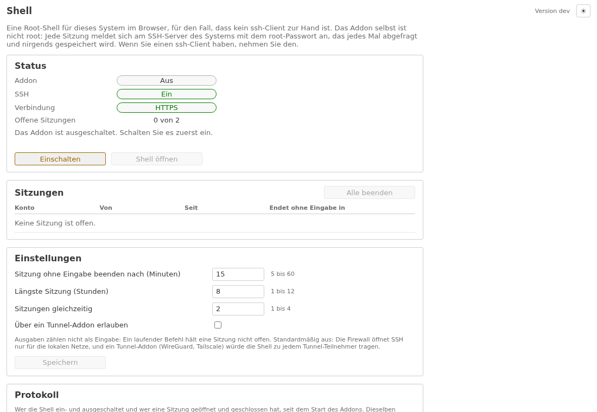
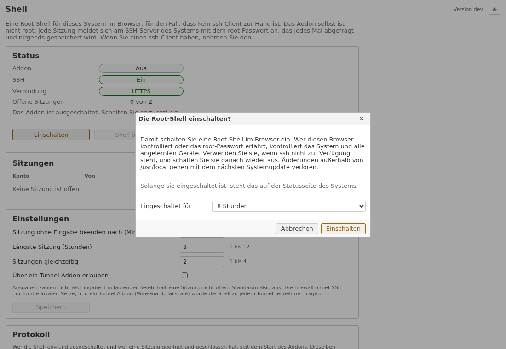
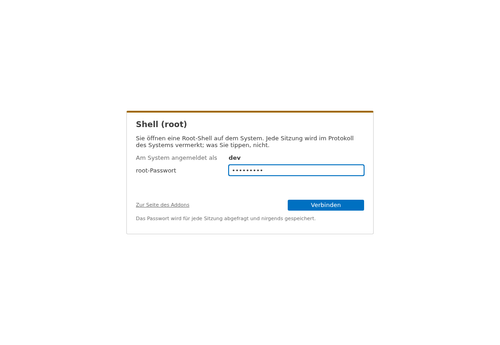
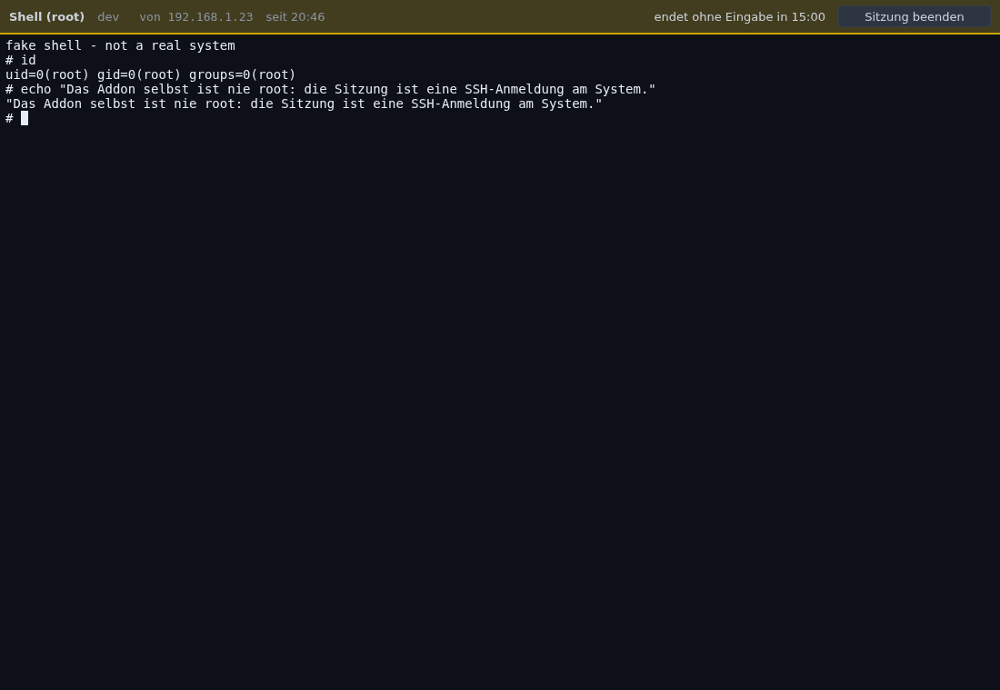

# lite-addon-shell

*[Deutsch](README.md)*

> **Needs openccu-lite 2.0.0-beta.7 or newer.** An older system refuses the install. **If you have an ssh client,
> use it** - it is the better terminal in every respect. This addon is for when there is none.

A **root shell in the browser** for [openccu-lite](https://github.com/openccu-lite/openccu-lite): a terminal in a
tab of its own, for a tablet or a phone, a managed PC without an ssh client, or a system you reach only through
its web server.


## How root is obtained, and why that matters

openccu-lite keeps root away from its web interface on purpose: the system service runs without privileges, and
what needs root goes through a small helper that does only what its list names. An addon that ran as root and
handed out a shell to whoever is signed in would undo that. **This addon does not run as root, and cannot become
root by itself.**

- It runs **confined**: its own user, no capability, no group, no port, and **no scope on the system's API**.
- A session is an **SSH sign-in to the system's own SSH server** on the loopback (`127.0.0.1:22`), as `root`,
  with **root's password, which you type for each session**. The password is handed to the SSH connection and
  kept nowhere: not in a file, not in the log, not for a reconnect.
- So the door is the one that exists already: **SSH has to be switched on** (*System → Remote access*). The addon
  never switches it on, *SSH off* also switches the shell off, and a system that takes keys only gets no shell
  from this version.
- No code of the addon runs as root. The SSH server is the one the system ships, and it checks the password.

What changes is this: **root's password is now typed into a web page**, in a browser, on an origin that the
system's other pages and addons share. Whoever controls that browser, or learns root's password, controls the
system and every device paired with it. That is why the addon is off after the install, asks before it is
switched on, and switches itself off again.

## What it does

- **A terminal** (xterm.js) on a real pty: `TERM=xterm-256color`, UTF-8, follows the window's size, 5000 lines of
  scrollback in the browser (none on the system). Copy with Ctrl+Shift+C, paste with Ctrl+Shift+V, Shift+Insert
  or the context menu; Ctrl+C and Ctrl+V stay the terminal's. **A paste of several lines asks first**, once per
  session.
- **Off after the install.** An administrator switches it on for **1 hour, 8 hours (the default) or until it is
  switched off**. While it is on, the **system's Status page carries a notice**.
- **A bar that never goes away** while a session is open: *Shell (root)*, the account, the client's address, since
  when, and a countdown to the end without input. When a session has ended the bar says why.
- **Limits** (all three can be set on the addon's page):

  | | Default | Range |
  | --- | --- | --- |
  | A session ends without input after | 15 minutes | 5 to 60 |
  | Longest session | 8 hours | 1 to 12 |
  | Sessions at once, over all accounts | 2 | 1 to 4 |

  Output is not input: a running `tail -f` does not keep a root shell open. Five wrong passwords of one account
  or from one address lock the sign-in for 15 minutes; the SSH server's own limits apply as well.
- **Administrators only, with their web session.** An API token is refused, whatever its scope: a root shell is
  for a person, not a program. While the system runs without a login the addon cannot be switched on.
- **A session ends with the web session that opened it**: a logout, *sign out everywhere*, a password change, an
  expiry, a lowered account. The addon asks the system every 15 seconds, in a way that does not count as activity
  - an open terminal does not keep you signed in, and typing in it does not either. It also ends when the addon
  is switched off or its time is up, when SSH is switched off, when the addon's service stops (an update, a
  reboot), and when its tab stays closed for more than 30 seconds. A reload comes back to the session. For a shell
  that survives, use `tmux` (in
  [lite-addon-tools](https://github.com/openccu-lite/lite-addon-tools)).
- **Over HTTPS only.** Over plain HTTP the page says how to get there and opens nothing. Through a tunnel addon
  (WireGuard, Tailscale) the shell is **refused** unless an administrator allows it in the settings: the firewall
  opens SSH to the local networks only, and the shell should not quietly reach further than SSH does.
- **The terminal's page cannot be framed** and loads its own scripts only (`frame-ancestors 'none'`,
  `script-src 'self'`). The session's handle lives in the tab - in no address and no cookie - so another page on
  the system cannot attach to a session. Only the web session that opened a session can use it; another
  administrator can end it, not join it.
- **Audit lines**, in the system's log (unit `addon-shell`) and on the addon's page:
  `enabled until=… by=…`, `disabled by=… reason=…`, `session-open kind=terminal user=… client=… id=… auth=password`,
  `session-close id=… user=… reason=… duration=…`, `login-failed user=… client=… tries_left=…`, `login-locked …`,
  `settings by=…`. The SSH server writes its own line for each login. **What is typed and what a session shows is
  never logged**: it would put every password typed at a prompt into the log.
- German and English, light and dark.

Not in this version: a file browser and an editor, and a sign-in for systems that take keys only.

## What an attacker gains

| Attacker | With this addon installed and switched on |
| --- | --- |
| A stolen administrator session | The sign-in sheet, which wants root's password. Nothing new without it. |
| Another page on the system's origin (an addon's) | Cannot open or reach a session. **It can imitate the sign-in sheet** and ask for root's password: type it only in the tab the addon's page opened. |
| A compromised browser of an administrator | Reads and types in an open terminal, and learns root's password at the next sign-in. |
| A bug in the addon's own service | Code running as the addon's user: it rides the sessions open at that moment and sees the passwords typed afterwards. Root from the next sign-in on, not before. |
| Another process on the system | Can speak to the addon's loopback port and forge the web server's headers; it still needs an administrator's live web session and root's password. |
| Someone on the network | Nothing in clear: the shell is refused over plain HTTP. |

The changes in a root shell are yours to answer for, as over ssh. The root file system is read-only; what you
change outside `/usr/local` after remounting it is gone with the next system update.

## Installation

On the system's **Addons** page: *Shell* in the catalogue, marked **root access** - or upload the package for your
architecture from the [releases](https://github.com/openccu-lite/lite-addon-shell/releases)
(`shell-aarch64-<version>.tar.gz`, `shell-x86_64-<version>.tar.gz`). The addon is off afterwards.

1. Switch **SSH** on under *System → Remote access*, and set root's password there if you have not yet.
2. Open the system over **https://**.
3. On the addon's page: **Switch on**, choose for how long, then **Open shell**.
4. In the new tab: root's password, **Connect**.
5. Switch the addon off when you are done.

An uninstall removes the program; the settings stay in `/usr/local/etc/config/addons/shell` (two small files, no
secret) for a reinstall.

## Screenshots

| | |
| --- | --- |
|  |  |
|  |  |

## The addon's own API

Under `/addons/shell/api/v1`, behind the system's web server and its session gate; every route needs an
administrator's web session, every write the header `X-CCU-Addon-Request`. Nothing here is for a program.

| Route | |
| --- | --- |
| `GET /health` | `{ok, version, uptime_s}` |
| `GET /state` | Everything the page shows: `enabled`, `until`, `by`, `ssh` (`on`, `off`, `keys-only`, `unknown`), `transport` (`https`, `http`, `tunnel`), `blocked` (`insecure-transport`, `tunnel-refused` or empty), `auth_off`, `settings`, `bounds`, `windows`, `sessions`, `locked_until` |
| `PUT /enabled` | `{on, hours}`: the switch; `hours` is 1, 8 or 0 (until switched off). `409 auth-off` while the system has no login |
| `PUT /settings` | `{idle_minutes, max_hours, max_sessions, allow_tunnel}`; `422 invalid` outside the ranges |
| `POST /sessions` | `{password, cols, rows}`: signs in to the SSH server as root. `201 {session, handle}`; `409 disabled`, `ssh-off`, `keys-only`, `too-many-sessions {sessions}`, `auth-off`; `403 wrong-password {tries_left}`, `insecure-transport`, `tunnel-refused`; `429 locked {until}` |
| `DELETE /sessions/{id}` | Ends a session: one's own or, as an administrator, anyone's |
| `DELETE /sessions` | Ends every session: `{ended}` |
| `GET /sessions/{id}/tty` | The terminal's WebSocket, for the web session that opened the session. The first message is `{handle, cols, rows}`; then binary frames are the terminal's bytes, text frames control messages (`resize`, `ping` from the tab; `ready`, `pong`, `end {reason}` to it). Close codes: 4000 ended (the reason is the close reason), 4001 taken over by another tab, 4003 refused |
| `GET /events` | Server-Sent Events: `change` whenever the switch, the SSH server's state or the sessions changed |
| `GET /audit` | The audit lines since the service's start, newest first |

A session's end reasons: `exit`, `idle`, `max`, `signed-out`, `ended`, `addon-off`, `ssh-off`, `tab-closed`,
`connection`, `stopping`, `unverified` (the system could not be asked about the web session for two minutes).

## Development

```sh
go test ./...                                   # the units, against an SSH server of the test's own
SHELL_DOCKER=1 go test -count=1 ./test/sshd/     # end to end against a real OpenSSH sshd in docker
(cd ui && npm ci && npm run check && npm test && npm run build)
(cd ui && npx playwright install chromium && npx playwright test)   # the pages against scripts/dev-serve.sh
VERSION=0.1.0 scripts/build.sh                  # dist/shell-<arch>-<version>.tar.gz
```

`scripts/dev-serve.sh` runs the service against a stand-in for the system and an SSH server that speaks the real
protocol and runs a small shell of its own - no real shell, no real system. The service is Go
(`golang.org/x/crypto/ssh`, `github.com/coder/websocket`, the
[ccu-addon-kit](https://github.com/hobbyquaker/ccu-addon-kit)); the pages are Svelte 5 on
[occulite-ui](https://github.com/openccu-lite/occulite-ui) with [xterm.js](https://xtermjs.org/).

## Licence

MIT. xterm.js is MIT, `golang.org/x/crypto` BSD-3-Clause, `github.com/coder/websocket` ISC.
