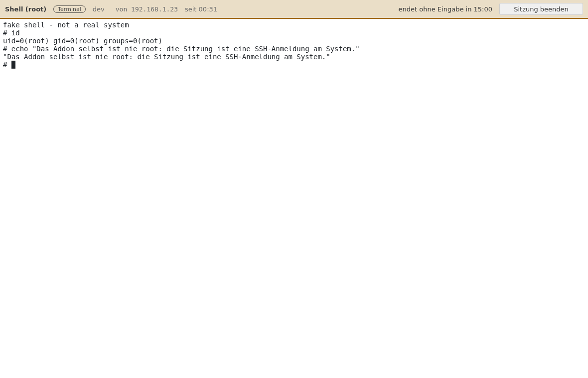
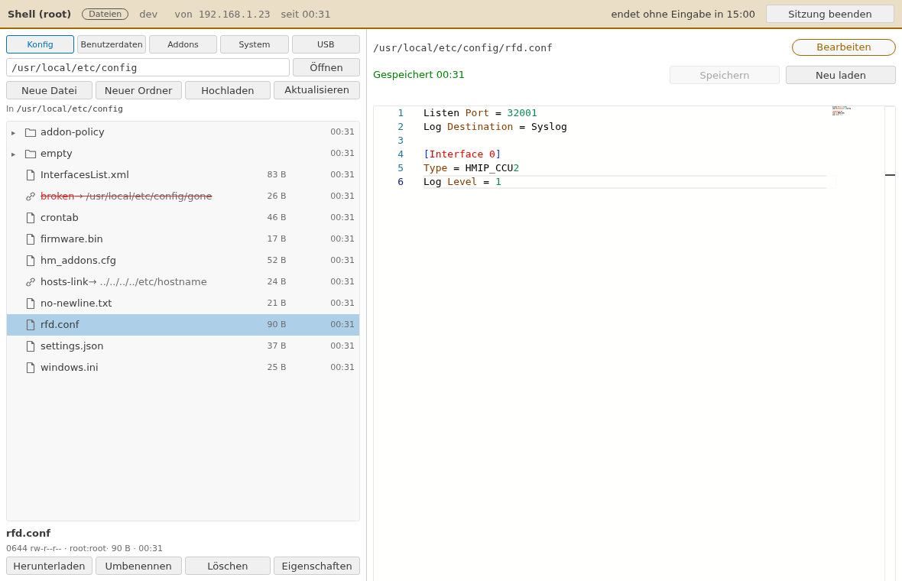
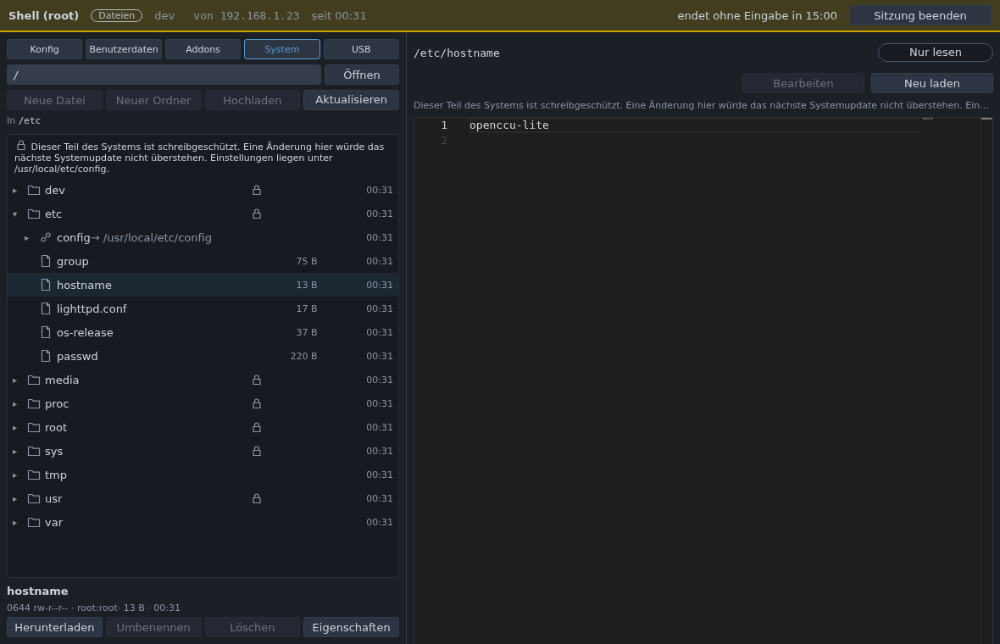

# lite-addon-shell

*[Deutsch](README.md)*

> **Needs openccu-lite 2.0.0-beta.7 or newer.** An older system refuses the install. **If you have an ssh client,
> use it** - it is the better terminal in every respect. This addon is for when there is none.

A **root shell and root's files in the browser** for [openccu-lite](https://github.com/openccu-lite/openccu-lite):
a terminal, and a file browser with an editor, each in a tab of its own - for a tablet or a phone, a managed PC
without an ssh client, or a system you reach only through its web server.





## How root is obtained, and why that matters

openccu-lite keeps root away from its web interface on purpose: the system service runs without privileges, and
what needs root goes through a small helper that does only what its list names. An addon that ran as root and
handed out a shell to whoever is signed in would undo that. **This addon does not run as root, and cannot become
root by itself.**

- It runs **confined**: its own user, no capability, no group, no port, and **no scope on the system's API**.
- A session is an **SSH sign-in to the system's own SSH server** on the loopback (`127.0.0.1:22`), as `root`,
  with **root's password, which you type for each session**. The password is handed to the SSH connection and
  kept nowhere: not in a file, not in the log, not for a reconnect.
- So the door is the one that exists already: **SSH has to be switched on** (*System → Remote access*). The addon
  never switches it on, *SSH off* also switches the shell off, and a system that takes keys only gets no shell
  from this version.
- **The files page goes the same way**: over the SFTP part of that same kind of SSH sign-in. The addon's service
  opens no file of the system itself; every path is handed to the system's own SFTP server, which follows links
  and decides what root may do.
- No code of the addon runs as root. The SSH server is the one the system ships, and it checks the password.

What changes is this: **root's password is now typed into a web page**, in a browser, on an origin that the
system's other pages and addons share. Whoever controls that browser, or learns root's password, controls the
system and every device paired with it. That is why the addon is off after the install, asks before it is
switched on, and switches itself off again.

## What it does

- **A terminal** (xterm.js) on a real pty: `TERM=xterm-256color`, UTF-8, follows the window's size, 5000 lines of
  scrollback in the browser (none on the system). Copy with Ctrl+Shift+C, paste with Ctrl+Shift+V, Shift+Insert
  or the context menu; Ctrl+C and Ctrl+V stay the terminal's. **A paste of several lines asks first**, once per
  session.
- **Files**: a tree of the system's folders beside an editor, in a tab of its own. See [Files](#files) below.
- **Off after the install.** An administrator switches it on for **1 hour, 8 hours (the default) or until it is
  switched off**. While it is on, the **system's Status page carries a notice**.
- **A bar that never goes away** while a session is open: *Shell (root)*, the kind of session (*Terminal* or
  *Files*), the account, the client's address, since when, and a countdown to the end without input. When a session has ended the bar says why.
- **Limits** (all three can be set on the addon's page):

  | | Default | Range |
  | --- | --- | --- |
  | A session ends without input after | 15 minutes | 5 to 60 |
  | Longest session | 8 hours | 1 to 12 |
  | Sessions at once, over all accounts | 2 | 1 to 4 |

  Output is not input: a running `tail -f` does not keep a root shell open. On the files page every action
  (opening a folder, saving) is input. Terminals and files sessions count against the one limit. Five wrong
  passwords of one account
  or from one address lock the sign-in for 15 minutes; the SSH server's own limits apply as well.
- **Administrators only, with their web session.** An API token is refused, whatever its scope: a root shell is
  for a person, not a program. While the system runs without a login the addon cannot be switched on.
- **A session ends with the web session that opened it**: a logout, *sign out everywhere*, a password change, an
  expiry, a lowered account. The addon asks the system every 15 seconds, in a way that does not count as activity
  - an open terminal does not keep you signed in, and typing in it does not either. It also ends when the addon
  is switched off or its time is up, when SSH is switched off, when the addon's service stops (an update, a
  reboot), and when its tab stays closed for more than 30 seconds. A reload comes back to the session. For a shell
  that survives, use `tmux` (in
  [lite-addon-tools](https://github.com/openccu-lite/lite-addon-tools)).
- **Over HTTPS only.** Over plain HTTP the page says how to get there and opens nothing. Through a tunnel addon
  (WireGuard, Tailscale) the shell is **refused** unless an administrator allows it in the settings: the firewall
  opens SSH to the local networks only, and the shell should not quietly reach further than SSH does.
- **The terminal's page and the files page cannot be framed** and load their own scripts only
  (`frame-ancestors 'none'`, `script-src 'self'`; the editor's workers are files of the page). The session's handle
  lives in the tab - in no address and no cookie; the files page sends it in a header, and a download goes through
  a ticket for that one download - so another page on the system cannot attach to a session. Only the web session that opened a session can use it; another
  administrator can end it, not join it.
- **Audit lines**, in the system's log (unit `addon-shell`) and on the addon's page:
  `enabled until=… by=…`, `disabled by=… reason=…`, `session-open kind=terminal|files user=… client=… id=… auth=password`,
  `session-close id=… user=… reason=… duration=…`, `login-failed user=… client=… tries_left=…`, `login-locked …`,
  `settings by=…`, and for files `file-write id=… user=… path="…" bytes=… backup="…" in_place=…`, `file-create`,
  `file-delete path="…" entries=…`, `file-rename from="…" to="…"`, `file-chmod path="…" mode=…`,
  `file-chown path="…" uid=… gid=…`, `file-upload`, `file-download`, `file-restore path="…" from="…"`. The SSH
  server writes its own line for each login. **What is typed, what a session shows and what a file holds is never
  logged**: it would put every password typed at a prompt, and every secret in a file, into the log.
- German and English, light and dark.

Not in this version: a sign-in for systems that take keys only.

## Files


- **A tree** of folders, opened in place, starting at the configuration (`/usr/local/etc/config`), the user file
  system, the addons, the whole system or a USB stick - or any path you type. A link shows where it leads and is
  followed only when you click it; a broken one is marked.
- **An editor** ([Monaco](https://microsoft.github.io/monaco-editor/)) that colours shell scripts, JSON (with
  validation), INI, `*.conf` and systemd units, XML, YAML, Tcl, Lua, Python, JavaScript, HTML, CSS, Markdown and
  Dockerfiles. One file at a time. **On a phone it is a plain text field**: the large editor does not work well
  with a touch keyboard, and a phone does not have to load it.
- **Every file opens read-only.** *Edit* makes it writable; a setting on the addon's page makes the files page
  read-only altogether.
- **The read-only root file system is shown as such.** Outside the writable mounts (the user file system
  `/usr/local`, USB media, the temporary file systems) folders carry a lock, and *Edit*, *New*, *Rename*, *Delete*
  and *Upload* are switched off and say why: a change there would not survive the next system update. The addon
  never remounts anything. `/etc/config` is a link into the user file system and can be changed.
- **A save changes what you changed and nothing else.** It keeps the file's mode, owner and group, its line ends
  (Unix or Windows), a missing last line end, and a byte order mark. It refuses when the file on the system is
  not what you opened (compared by its content): *Overwrite*, *Reload* or *Compare* side by side. The new content
  is written to a file beside the old one, flushed to the disk, and renamed over it, so nobody ever reads half a
  file. Where that is impossible - a file that is a mount of its own, a folder that takes no new file - it is
  written in place, and the status line says *written in place*. A full disk fails the save and leaves the file
  as it was; what you typed stays in the editor.
- **Every overwritten file is backed up first**, to `/usr/local/shell-backups/<folder>/<name>.<time>`, written as
  root over your own session: folders `0700`, files `0600`, so the addon's own user cannot read them between
  sessions, and with a `.nobackup` at the top, so the system backup does not multiply copies of secrets. The
  **last 10 versions of each file and 50 MB in all** are kept. A file's *Properties* list them: *Compare*,
  *Restore* (which backs up the present version first). Without a backup there is no save. **The backups stay
  when the addon is uninstalled** - they may be the only copy of a file you overwrote.
- **Binary and large files.** A file with a NUL byte in its first 8 KiB, or one that is not UTF-8, is binary: its
  first 64 KiB as a hex view, and *Download*. Up to 2 MB a text file can be edited, up to 10 MB it is shown, above
  that it is offered as a download. Devices, pipes and sockets are never opened. Files under `/proc` and `/sys`
  are read up to 1 MB and never written.
- **Upload** (several files, or drag them onto the tree; 64 MB each, streamed; an existing file is replaced only
  after a question, and backed up first when it is at most 50 MB), **download** of a file, **new file**, **new
  folder**, **rename** (also to another folder; never over something that exists), **delete** (asks; a folder
  with something in it wants its name typed; a link is deleted, not what it leads to), and **mode and owner** of
  one entry - never of what is in a folder, never through a link.
- **A files session is a session like a terminal**: the same sign-in with root's password, the same limits and
  the same ends, the same bar. Only the web session that opened it can use it.

What it does not do: download a folder, search through files, open several files at once. A file with several
hard links is replaced by a save, not written in place: the other names keep the old content. Names with control
characters are shown but cannot be acted on. Text is UTF-8.

## What an attacker gains

| Attacker | With this addon installed and switched on |
| --- | --- |
| A stolen administrator session | The sign-in sheet, which wants root's password. Nothing new without it. |
| Another page on the system's origin (an addon's) | Cannot open or reach a session. **It can imitate the sign-in sheet** and ask for root's password: type it only in the tab the addon's page opened. |
| A compromised browser of an administrator | Reads and types in an open terminal, reads and writes files in an open files session, and learns root's password at the next sign-in. |
| A bug in the addon's own service | Code running as the addon's user: it rides the sessions open at that moment (a terminal, or files) and sees the passwords typed afterwards. Root from the next sign-in on, not before. It cannot read the editor's backups between sessions. |
| Another process on the system | Can speak to the addon's loopback port and forge the web server's headers; it still needs an administrator's live web session and root's password. |
| Someone on the network | Nothing in clear: the shell is refused over plain HTTP. |

The changes in a root shell and on the files page are yours to answer for, as over ssh: the editor does not know
what a file means, and restarts nothing. The root file system is read-only; what you change outside `/usr/local`
after remounting it in a terminal is gone with the next system update.

## Installation

On the system's **Addons** page: *Shell* in the catalogue, marked **root access** - or upload the package for your
architecture from the [releases](https://github.com/openccu-lite/lite-addon-shell/releases)
(`shell-aarch64-<version>.tar.gz`, `shell-x86_64-<version>.tar.gz`). The addon is off afterwards.

1. Switch **SSH** on under *System → Remote access*, and set root's password there if you have not yet.
2. Open the system over **https://**.
3. On the addon's page: **Switch on**, choose for how long, then **Open shell** or **Open files**.
4. In the new tab: root's password, **Connect**.
5. Switch the addon off when you are done.

An uninstall removes the program; the limits stay in `/usr/local/etc/config/addons/shell` (one small file, no
secret) for a reinstall. The switch does not: after every install the addon is off. **The editor's backups in
`/usr/local/shell-backups` stay too**: they are root's, and may be the only copy of a file you overwrote. Remove
that folder yourself (over ssh, or in a terminal session before the uninstall) when you no longer need it.

The package is about 5 MB; the editor is most of it, and a browser loads it once, when the first file is opened.

## Screenshots

| | |
| --- | --- |
|  |  |
|  |  |
|  |  |

## The addon's own API

Under `/addons/shell/api/v1`, behind the system's web server and its session gate; every route needs an
administrator's web session, every write the header `X-CCU-Addon-Request`. Nothing here is for a program.

| Route | |
| --- | --- |
| `GET /health` | `{ok, version, uptime_s}` |
| `GET /state` | Everything the page shows: `enabled`, `until`, `by`, `ssh` (`on`, `off`, `keys-only`, `unknown`), `transport` (`https`, `http`, `tunnel`), `blocked` (`insecure-transport`, `tunnel-refused` or empty), `auth_off`, `settings`, `bounds`, `windows`, `sessions`, `locked_until` |
| `PUT /enabled` | `{on, hours}`: the switch; `hours` is 1, 8 or 0 (until switched off). `409 auth-off` while the system has no login |
| `PUT /settings` | `{idle_minutes, max_hours, max_sessions, allow_tunnel, files_read_only}`; `422 invalid` outside the ranges |
| `POST /sessions` | `{kind, password, cols, rows}`: signs in to the SSH server as root; `kind` is `terminal` (the default) or `files`. `201 {session, handle}`; `409 disabled`, `ssh-off`, `keys-only`, `too-many-sessions {sessions}`, `auth-off`; `403 wrong-password {tries_left}`, `insecure-transport`, `tunnel-refused`; `429 locked {until}`; `502 no-sftp` for files where the SSH server offers no SFTP |
| `DELETE /sessions/{id}` | Ends a session: one's own or, as an administrator, anyone's |
| `DELETE /sessions` | Ends every session: `{ended}` |
| `GET /sessions/{id}/tty` | The terminal's WebSocket, for the web session that opened the session. The first message is `{handle, cols, rows}`; then binary frames are the terminal's bytes, text frames control messages (`resize`, `ping` from the tab; `ready`, `pong`, `end {reason}` to it). Close codes: 4000 ended (the reason is the close reason), 4001 taken over by another tab, 4003 refused |
| `GET /sessions/{id}/link` | A files session's WebSocket, for the web session that opened it: the first message is `{handle}`; it carries no file, it holds the session for the tab (a tab gone for 30 seconds ends it) and says `end {reason}` at once. Close codes as above |
| `GET /sessions/{id}/fs/list` | `?path=`: a folder - `{path, real, entries: [{name, type, size, mode, uid, gid, owner, group, mtime, target, target_type, locked}], truncated, writable, reason, mount, files_read_only}`. `reason` and `locked` are `read-only` (a read-only mount), `kernel` (`/proc`, `/sys`, `/dev`) or `backups` |
| `GET /sessions/{id}/fs/stat` | `?path=`: one entry, a link as itself |
| `GET /sessions/{id}/fs/read` | `?path=`: a file for the editor. The body is its bytes (a binary file's first 64 KiB), the header `X-Shell-File` its description as JSON: `kind` (`text`, `binary`), `sha256`, `editable`, `why` (`binary`, `large`, `read-only`, `kernel`, `backups`, `setting`), `real`, `size`, `mode`, ... `413 too-large` over 10 MB, `422 special` for a device, a pipe or a socket |
| `GET /sessions/{id}/fs/ids` | The system's accounts and groups: `{users, groups}` |
| `GET /sessions/{id}/fs/backups` | `?path=`: the kept versions of a file, newest first: `{backups: [{name, path, at, size}], keep, keep_bytes, root}` |
| `PUT /sessions/{id}/fs/write` | `?path=`, the body is the new content (at most 2 MB), `If-Match: "<sha256 of the content it replaces>"`. `200 {size, mtime, mode, sha256, backup, in_place}`; `409 conflict {size, mtime, sha256}` when the file is something else by now, `428 precondition` without `If-Match`, `507 no-space` |
| `POST /sessions/{id}/fs/create` | `{path}`: a new, empty file. `409 exists` |
| `POST /sessions/{id}/fs/mkdir` | `{path}`: a new folder |
| `POST /sessions/{id}/fs/rename` | `{from, to}`: to a name that is free; `409 exists` otherwise |
| `POST /sessions/{id}/fs/remove` | `{path, recursive}`: `409 not-empty {entries}` for a folder with something in it, unless `recursive`. A link is removed, never followed |
| `POST /sessions/{id}/fs/chmod` | `{path, mode}`: `mode` as octal digits. This one entry, never a link |
| `POST /sessions/{id}/fs/chown` | `{path, uid, gid}`. This one entry, never a link |
| `POST /sessions/{id}/fs/upload` | `?path=&overwrite=1`, the body is the file (streamed, at most 64 MB). `201 {size, backup, backup_skipped, created}`; `409 exists` without `overwrite`, `413 too-large` |
| `POST /sessions/{id}/fs/restore` | `{path, name}`: puts a kept version back; the present one is backed up first |
| `POST /sessions/{id}/fs/download` | `{path}`: a ticket for one download: `{ticket, name, size}` |
| `GET /sessions/{id}/fs/download/{ticket}` | The file, as an attachment. The ticket is good once, for 30 seconds, for the web session it was made for; this is the one request for files without the handle |
| `GET /events` | Server-Sent Events: `change` whenever the switch, the SSH server's state or the sessions changed |
| `GET /audit` | The audit lines since the service's start, newest first |

A session's end reasons: `exit`, `idle`, `max`, `signed-out`, `ended`, `addon-off`, `ssh-off`, `tab-closed`,
`connection`, `stopping`, `unverified` (the system could not be asked about the web session for two minutes),
`stuck` (a file did not answer a read within 15 seconds - a few of the kernel's never do - and the SFTP server
would wait on it for good).

Every request under `/sessions/{id}/fs/` carries the session's handle in the header `X-Shell-Handle` (never in the
address) and comes from the web session that opened the session; anything else is `403 no-session`. Paths are
absolute; the service cleans them and hands them to the system's SFTP server. The refusals: `403 read-only`,
`kernel`, `backups`, `permission-denied`, `is-link`, `read-only-setting` (the files page is set to read-only);
`404 not-found`; `422 invalid-path`, `invalid`, `not-a-file`, `not-a-directory`, `special`; `507 no-space`;
`502 backup-failed`, `failed`.

## Development

```sh
go test ./...                                   # the units, against an SSH and SFTP server of the test's own
SHELL_DOCKER=1 go test -count=1 ./test/sshd/     # end to end against a real OpenSSH sshd in docker
(cd ui && npm ci && npm run check && npm test && npm run build)
(cd ui && npx playwright install chromium && npx playwright test)   # the pages against scripts/dev-serve.sh
VERSION=0.2.0 scripts/build.sh                  # dist/shell-<arch>-<version>.tar.gz
```

`scripts/dev-serve.sh` runs the service against a stand-in for the system and an SSH server that speaks the real
protocol, runs a small shell of its own and serves a scratch folder, filled like a small system, over SFTP - no
real shell, no real system, no file outside that folder. The service is Go (`golang.org/x/crypto/ssh`,
`github.com/pkg/sftp`, `github.com/coder/websocket`, the
[ccu-addon-kit](https://github.com/hobbyquaker/ccu-addon-kit)); the pages are Svelte 5 on
[occulite-ui](https://github.com/openccu-lite/occulite-ui) with [xterm.js](https://xtermjs.org/) and
[Monaco](https://microsoft.github.io/monaco-editor/) (its core, the tokenizers named above and the JSON service;
no TypeScript, CSS or HTML service).

## Licence

MIT. xterm.js and Monaco are MIT, `golang.org/x/crypto` BSD-3-Clause, `github.com/pkg/sftp` BSD-2-Clause,
`github.com/coder/websocket` ISC.
