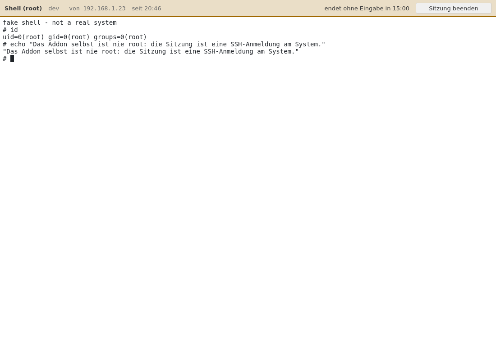
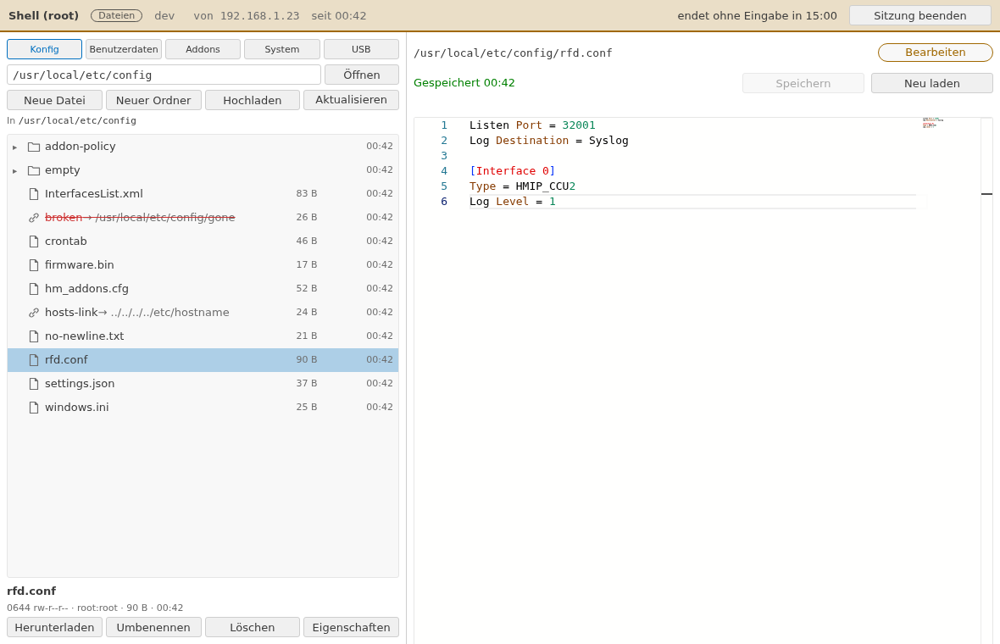
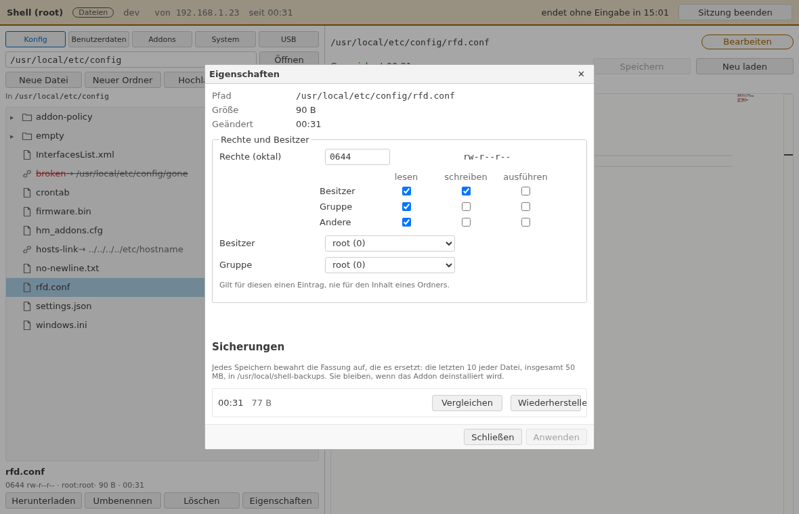
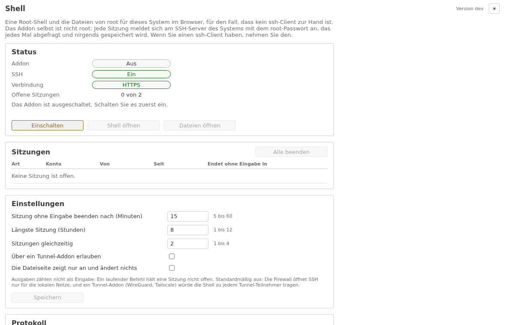
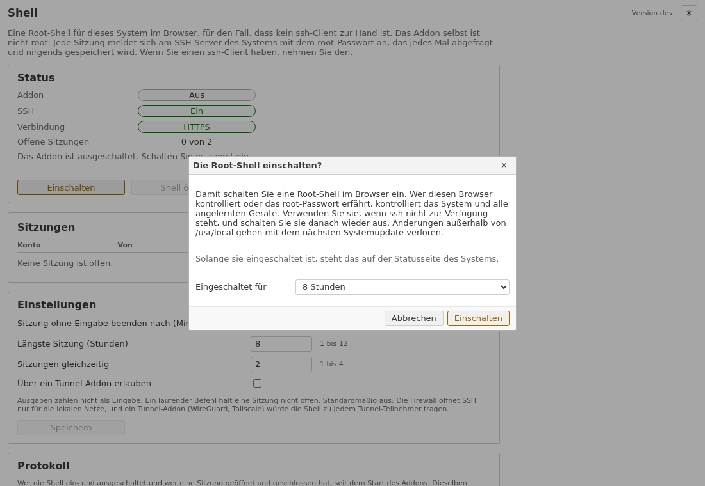
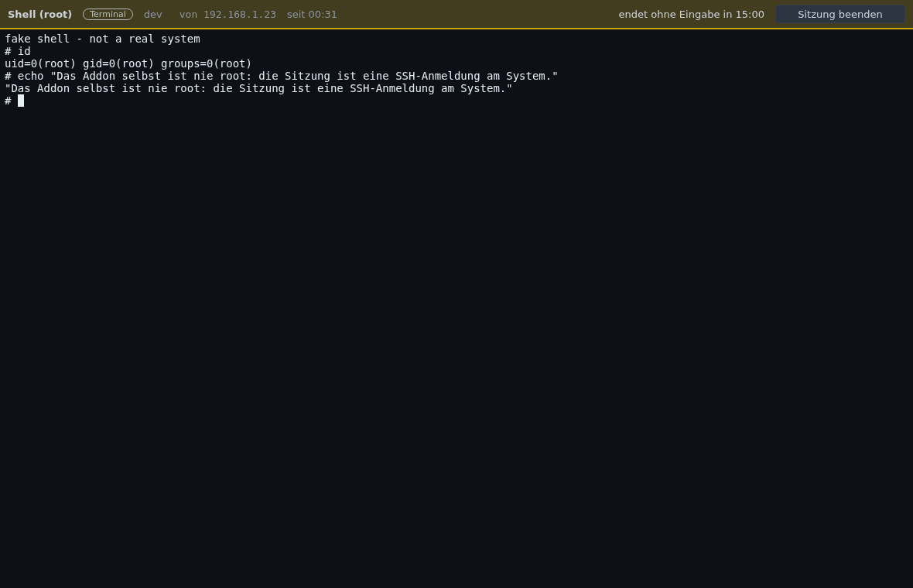
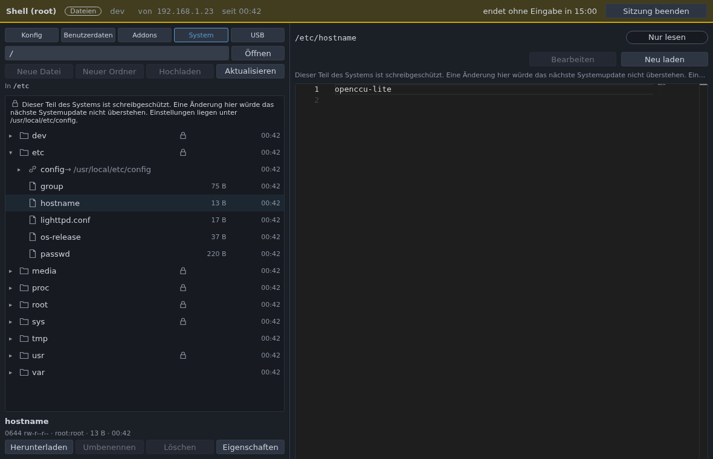

# lite-addon-shell

*[English](README.en.md)*

> **Braucht openccu-lite 2.0.0-beta.7 oder neuer.** Ein älteres System verweigert die Installation. **Wenn Sie
> einen ssh-Client haben, nehmen Sie den** - er ist in jeder Hinsicht das bessere Terminal. Dieses Addon ist für
> den Fall, dass keiner da ist.

Eine **Root-Shell und die Dateien von root im Browser** für
[openccu-lite](https://github.com/openccu-lite/openccu-lite): ein Terminal und ein Dateibrowser mit Editor, jeweils
in einem eigenen Tab - für ein Tablet oder Telefon, einen verwalteten PC ohne ssh-Client oder ein System, das Sie
nur über seinen Webserver erreichen.





## Wie root erlangt wird, und warum das wichtig ist

openccu-lite hält root mit Absicht von seiner Weboberfläche fern: Der Systemdienst läuft ohne Sonderrechte, und was
root braucht, geht über einen kleinen Helfer, der nur tut, was seine Liste nennt. Ein Addon, das als root liefe und
jedem Angemeldeten eine Shell gäbe, würde das aufheben. **Dieses Addon läuft nicht als root und kann es von sich aus
nicht werden.**

- Es läuft **eingeschränkt**: eigener Benutzer, kein Zusatzrecht, keine Gruppe, kein Port und **kein Recht an der
  System-API**.
- Eine Sitzung ist eine **SSH-Anmeldung am SSH-Server des Systems** auf der Loopback-Adresse (`127.0.0.1:22`), als
  `root`, mit dem **root-Passwort, das Sie für jede Sitzung eingeben**. Das Passwort geht an die SSH-Verbindung und
  wird nirgends aufbewahrt: in keiner Datei, nicht im Protokoll, nicht für einen erneuten Verbindungsaufbau.
- Die Tür ist also die, die es schon gibt: **SSH muss eingeschaltet sein** (*System → Fernzugriff*). Das Addon
  schaltet es nie selbst ein, *SSH aus* schaltet auch die Shell aus, und ein System, das nur Schlüssel annimmt,
  bekommt von dieser Version keine Shell.
- **Die Dateiseite geht denselben Weg**: über den SFTP-Teil einer solchen SSH-Anmeldung. Der Dienst des Addons
  öffnet selbst keine Datei des Systems; jeder Pfad geht an den SFTP-Server des Systems, der Links folgt und
  entscheidet, was root darf.
- Kein Code des Addons läuft als root. Der SSH-Server ist der, den das System mitbringt, und er prüft das Passwort.

Was sich ändert: **Das root-Passwort wird jetzt in eine Webseite getippt**, in einem Browser, auf einem Origin, den
sich die anderen Seiten und Addons des Systems teilen. Wer diesen Browser kontrolliert oder das root-Passwort
erfährt, kontrolliert das System und alle angelernten Geräte. Darum ist das Addon nach der Installation aus, fragt
vor dem Einschalten nach und schaltet sich selbst wieder aus.

## Was es tut

- **Ein Terminal** (xterm.js) auf einem echten pty: `TERM=xterm-256color`, UTF-8, folgt der Fenstergröße, 5000
  Zeilen Verlauf im Browser (keine auf dem System). Kopieren mit Strg+Umschalt+C, Einfügen mit Strg+Umschalt+V,
  Umschalt+Einfg oder dem Kontextmenü; Strg+C und Strg+V bleiben die des Terminals. **Beim Einfügen mehrerer Zeilen
  wird vorher gefragt**, einmal pro Sitzung.
- **Dateien**: ein Baum der Ordner des Systems neben einem Editor, in einem eigenen Tab. Siehe [Dateien](#dateien)
  weiter unten.
- **Nach der Installation aus.** Ein Administrator schaltet es für **1 Stunde, 8 Stunden (Vorgabe) oder bis zum
  Ausschalten** ein. Solange es ein ist, steht ein **Hinweis auf der Statusseite des Systems**.
- **Eine Leiste, die nie verschwindet**, solange eine Sitzung offen ist: *Shell (root)*, die Art der Sitzung
  (*Terminal* oder *Dateien*), das Konto, die Adresse des Clients, seit wann, und ein Countdown bis zum Ende ohne
  Eingabe. Ist eine Sitzung beendet, nennt die Leiste den
  Grund.
- **Limits** (alle drei auf der Seite des Addons einstellbar):

  | | Vorgabe | Bereich |
  | --- | --- | --- |
  | Eine Sitzung endet ohne Eingabe nach | 15 Minuten | 5 bis 60 |
  | Längste Sitzung | 8 Stunden | 1 bis 12 |
  | Sitzungen gleichzeitig, über alle Konten | 2 | 1 bis 4 |

  Ausgaben sind keine Eingabe: Ein laufendes `tail -f` hält keine Root-Shell offen. Auf der Dateiseite ist jede
  Aktion (einen Ordner öffnen, speichern) eine Eingabe. Terminals und Dateisitzungen zählen gegen dieselbe Grenze.
  Fünf falsche Passwörter eines
  Kontos oder von einer Adresse sperren die Anmeldung für 15 Minuten. **Der SSH-Server hat eine eigene Grenze**:
  Nach etwa drei Fehlversuchen von einer Adresse nimmt er von dieser Adresse eine Weile keine Verbindung mehr an
  (zuerst 15 Sekunden, mit jedem weiteren Fehlversuch länger) - und über das Addon ist diese Adresse das System
  selbst, es warten also alle, die sich hier anmelden, auch mit dem richtigen Passwort. Die Seiten sagen das
  (*SSH: Gerade nicht*) und schauen von selbst wieder nach.
- **Nur für Administratoren, mit ihrer Web-Sitzung.** Ein API-Token wird abgewiesen, gleich mit welchem Recht: Eine
  Root-Shell ist für einen Menschen, nicht für ein Programm. Läuft das System ohne Anmeldung, lässt sich das Addon
  nicht einschalten.
- **Eine Sitzung endet mit der Web-Sitzung, die sie geöffnet hat**: Abmelden, *überall abmelden*, eine
  Passwortänderung, der Ablauf, ein herabgestuftes Konto. Das Addon fragt das System alle 15 Sekunden, und zwar so,
  dass es nicht als Aktivität zählt - ein offenes Terminal hält Sie nicht angemeldet, und Tippen darin auch nicht.
  Sie endet außerdem, wenn das Addon ausgeschaltet wird oder seine Zeit um ist, wenn SSH ausgeschaltet wird, wenn
  der Dienst des Addons endet (ein Update, ein Neustart) und wenn ihr Tab länger als 30 Sekunden geschlossen
  bleibt. Ein Neuladen kommt zur Sitzung zurück. Für eine Shell, die überlebt, nehmen Sie `tmux` (in
  [lite-addon-tools](https://github.com/openccu-lite/lite-addon-tools)).
- **Nur über HTTPS.** Über einfaches HTTP sagt die Seite, wie Sie dorthin kommen, und öffnet nichts. Über ein
  Tunnel-Addon (WireGuard, Tailscale) wird die Shell **abgewiesen**, solange ein Administrator es nicht in den
  Einstellungen erlaubt: Die Firewall öffnet SSH nur für die lokalen Netze, und die Shell soll nicht still weiter
  reichen als SSH.
- **Die Seite des Terminals und die Dateiseite lassen sich nicht einbetten** und laden nur ihre eigenen Skripte
  (`frame-ancestors 'none'`, `script-src 'self'`; die Worker des Editors sind Dateien der Seite). Das Handle der
  Sitzung lebt im Tab - in keiner Adresse und in keinem Cookie; die Dateiseite schickt es in einer Kopfzeile, und
  ein Download läuft über ein Ticket für genau diesen einen Download -, eine andere Seite auf dem System kann sich
  also an keine Sitzung hängen. Nur die Web-Sitzung, die
  eine Sitzung geöffnet hat, kann sie benutzen; ein anderer Administrator kann sie beenden, nicht mitbenutzen.
- **Protokollzeilen**, im Protokoll des Systems (Unit `addon-shell`) und auf der Seite des Addons:
  `enabled until=… by=…`, `disabled by=… reason=…`, `session-open kind=terminal|files user=… client=… id=… auth=password`,
  `session-close id=… user=… reason=… duration=…`, `login-failed user=… client=… tries_left=…`, `login-locked …`,
  `settings by=…`, und für Dateien `file-write id=… user=… path="…" bytes=… backup="…" in_place=…`, `file-create`,
  `file-delete path="…" entries=…`, `file-rename from="…" to="…"`, `file-chmod path="…" mode=…`,
  `file-chown path="…" uid=… gid=…`, `file-upload`, `file-download`, `file-restore path="…" from="…"`. Der
  SSH-Server schreibt für jede Anmeldung seine eigene Zeile. **Was getippt wird, was eine Sitzung zeigt und was in
  einer Datei steht, wird nie protokolliert**: Es brächte jedes Passwort, das an einer Eingabeaufforderung getippt
  wird, und jedes Geheimnis in einer Datei ins Protokoll.
- Deutsch und Englisch, hell und dunkel.

Nicht in dieser Version: eine Anmeldung für Systeme, die nur Schlüssel annehmen.

## Dateien



- **Ein Baum** der Ordner, an Ort und Stelle aufgeklappt, beginnend bei der Konfiguration
  (`/usr/local/etc/config`), den Benutzerdaten, den Addons, dem ganzen System oder einem USB-Stick - oder bei jedem
  Pfad, den Sie eintippen. Ein Link zeigt, wohin er führt, und wird erst beim Anklicken verfolgt; ein defekter ist
  markiert.
- **Ein Editor** ([Monaco](https://microsoft.github.io/monaco-editor/)), der Shell-Skripte, JSON (mit Prüfung),
  INI, `*.conf` und systemd-Units, XML, YAML, Tcl, Lua, Python, JavaScript, HTML, CSS, Markdown und Dockerfiles
  einfärbt. Eine Datei zur Zeit. **Auf einem Telefon ist es ein einfaches Textfeld**: Der große Editor verträgt
  sich schlecht mit einer Bildschirmtastatur, und ein Telefon muss ihn nicht laden.
- **Jede Datei wird schreibgeschützt geöffnet.** *Bearbeiten* macht sie schreibbar; eine Einstellung auf der Seite
  des Addons stellt die Dateiseite ganz auf Nur-Lesen.
- **Das schreibgeschützte Root-Dateisystem wird als solches gezeigt.** Außerhalb der schreibbaren Dateisysteme
  (die Benutzerdaten unter `/usr/local`, USB-Medien, die temporären Dateisysteme) tragen Ordner ein Schloss, und
  *Bearbeiten*, *Neu*, *Umbenennen*, *Löschen* und *Hochladen* sind abgeschaltet und sagen, warum: Eine Änderung
  dort würde das nächste Systemupdate nicht überstehen. Das Addon hängt nie etwas neu ein. `/etc/config` ist ein
  Link in die Benutzerdaten und lässt sich ändern.
- **Speichern ändert, was Sie geändert haben, und sonst nichts.** Es erhält Rechte, Besitzer und Gruppe der Datei,
  ihre Zeilenenden (Unix oder Windows), ein fehlendes letztes Zeilenende und eine Byte-Order-Mark. Es lehnt ab,
  wenn die Datei auf dem System nicht mehr die ist, die Sie geöffnet haben (verglichen wird der Inhalt):
  *Überschreiben*, *Neu laden* oder *Vergleichen*, nebeneinander. Der neue Inhalt wird in eine Datei neben der
  alten geschrieben, auf den Datenträger gebracht und über die alte umbenannt - niemand liest je eine halbe Datei.
  Wo das nicht geht - eine Datei, die selbst eingehängt ist, ein Ordner, der keine neue Datei annimmt -, wird an
  Ort und Stelle geschrieben, und die Statuszeile sagt das. Ein voller Datenträger lässt das Speichern scheitern
  und die Datei, wie sie war; was Sie getippt haben, bleibt im Editor.
- **Jede überschriebene Datei wird vorher gesichert**, nach `/usr/local/shell-backups/<Ordner>/<Name>.<Zeit>`,
  geschrieben als root über Ihre eigene Sitzung: Ordner `0700`, Dateien `0600`, damit der Benutzer des Addons sie
  zwischen den Sitzungen nicht lesen kann, und mit einer `.nobackup` an der Spitze, damit die Systemsicherung
  Geheimnisse nicht vervielfältigt. Aufbewahrt werden **die letzten 10 Fassungen jeder Datei und insgesamt
  50 MB**. Die *Eigenschaften* einer Datei listen sie: *Vergleichen*, *Wiederherstellen* (was vorher die jetzige
  Fassung sichert). Ohne Sicherung wird nicht gespeichert. **Die Sicherungen bleiben, wenn das Addon deinstalliert
  wird** - sie können die einzige Kopie einer überschriebenen Datei sein.
- **Binäre und große Dateien.** Eine Datei mit einem NUL-Byte in den ersten 8 KiB oder eine, die kein UTF-8 ist,
  gilt als binär: ihre ersten 64 KiB als Hex-Ansicht, dazu *Herunterladen*. Bis 2 MB lässt sich eine Textdatei
  bearbeiten, bis 10 MB wird sie angezeigt, darüber nur zum Herunterladen angeboten. Geräte, Pipes und Sockets
  werden nie geöffnet. Dateien unter `/proc` und `/sys` werden bis 1 MB gelesen und nie geschrieben.
- **Hochladen** (mehrere Dateien, auch per Ziehen auf den Baum; je 64 MB, als Strom; eine vorhandene Datei wird
  erst nach einer Rückfrage ersetzt und bis 50 MB vorher gesichert), **Herunterladen** einer Datei, **neue Datei**,
  **neuer Ordner**, **Umbenennen** (auch in einen anderen Ordner; nie über etwas Vorhandenes), **Löschen** (fragt
  nach; bei einem Ordner mit Inhalt muss dessen Name eingetippt werden; ein Link wird gelöscht, nicht sein Ziel)
  sowie **Rechte und Besitzer** eines Eintrags - nie des Inhalts eines Ordners, nie durch einen Link hindurch.
- **Eine Dateisitzung ist eine Sitzung wie ein Terminal**: dieselbe Anmeldung mit dem root-Passwort, dieselben
  Limits und dieselben Enden, dieselbe Leiste. Nur die Web-Sitzung, die sie geöffnet hat, kann sie benutzen.

Was sie nicht kann: einen Ordner herunterladen, in Dateien suchen, mehrere Dateien zugleich öffnen. Eine Datei mit
mehreren harten Links wird beim Speichern ersetzt, nicht an Ort und Stelle geschrieben: Die anderen Namen behalten
den alten Inhalt. Namen mit Steuerzeichen werden angezeigt, lassen sich aber nicht bearbeiten. Text ist UTF-8.

## Was ein Angreifer gewinnt

| Angreifer | Mit installiertem und eingeschaltetem Addon |
| --- | --- |
| Eine gestohlene Administrator-Sitzung | Das Anmeldeblatt, das das root-Passwort will. Ohne das nichts Neues. |
| Eine andere Seite auf dem Origin des Systems (die eines Addons) | Kann keine Sitzung öffnen oder erreichen. **Sie kann das Anmeldeblatt nachahmen** und nach dem root-Passwort fragen: Tippen Sie es nur in dem Tab, den die Seite des Addons geöffnet hat. |
| Der kompromittierte Browser eines Administrators | Liest und tippt in einem offenen Terminal, liest und schreibt Dateien in einer offenen Dateisitzung und erfährt das root-Passwort bei der nächsten Anmeldung. |
| Ein Fehler im Dienst des Addons | Code, der als Benutzer des Addons läuft: Er reitet auf den gerade offenen Sitzungen mit (einem Terminal oder Dateien) und sieht die danach getippten Passwörter. Root ab der nächsten Anmeldung, nicht vorher. Die Sicherungen des Editors kann er zwischen den Sitzungen nicht lesen. |
| Ein anderer Prozess auf dem System | Kann mit dem Loopback-Port des Addons sprechen und die Kopfzeilen des Webservers fälschen; er braucht trotzdem die laufende Web-Sitzung eines Administrators und das root-Passwort. |
| Jemand im Netz | Nichts im Klartext: Über einfaches HTTP wird die Shell abgewiesen. |

Für die Änderungen in einer Root-Shell und auf der Dateiseite stehen Sie ein, wie über ssh: Der Editor weiß
nicht, was eine Datei bedeutet, und startet nichts neu. Das Root-Dateisystem ist schreibgeschützt; was Sie nach
einem Remount in einem Terminal außerhalb von `/usr/local` ändern, ist mit dem nächsten Systemupdate verloren.

## Installation

Auf der Seite **Addons** des Systems: *Shell* im Katalog, markiert mit **Root-Zugriff** - oder laden Sie das Paket
für Ihre Architektur aus den [Releases](https://github.com/openccu-lite/lite-addon-shell/releases) hoch
(`shell-aarch64-<version>.tar.gz`, `shell-x86_64-<version>.tar.gz`). Danach ist das Addon aus.

1. Schalten Sie **SSH** unter *System → Fernzugriff* ein und setzen Sie dort das root-Passwort, falls noch nicht
   geschehen.
2. Öffnen Sie das System über **https://**.
3. Auf der Seite des Addons: **Einschalten**, die Dauer wählen, dann **Shell öffnen** oder **Dateien öffnen**.
4. Im neuen Tab: das root-Passwort, **Verbinden**.
5. Schalten Sie das Addon aus, wenn Sie fertig sind.

Eine Deinstallation entfernt das Programm; die Limits bleiben für eine Neuinstallation in
`/usr/local/etc/config/addons/shell` (eine kleine Datei, kein Geheimnis). Der Schalter bleibt nicht: Nach jeder
Installation ist das Addon aus. **Auch die Sicherungen des Editors in `/usr/local/shell-backups` bleiben**: Sie
gehören root und können die einzige Kopie einer überschriebenen Datei sein. Entfernen Sie den Ordner selbst (über
ssh oder vor der Deinstallation in einer Terminal-Sitzung), wenn Sie ihn nicht mehr brauchen.

Das Paket hat etwa 5 MB; das meiste davon ist der Editor, und ein Browser lädt ihn einmal, wenn die erste Datei
geöffnet wird.

## Screenshots

| | |
| --- | --- |
|  |  |
|  |  |
|  |  |

## Die API des Addons

Die Routen unter `/addons/shell/api/v1` (jede braucht die Web-Sitzung eines Administrators, jeder Schreibzugriff
die Kopfzeile `X-CCU-Addon-Request`; nichts davon ist für ein Programm), das WebSocket-Protokoll des Terminals,
die Routen der Dateiseite (jede mit dem Handle der Sitzung in der Kopfzeile `X-Shell-Handle`, nie in der Adresse)
und die Gründe, aus denen eine Sitzung endet, stehen in der [englischen Fassung](README.en.md#the-addons-own-api).

## Entwicklung

```sh
go test ./...                                   # die Units, gegen einen SSH- und SFTP-Server des Tests
SHELL_DOCKER=1 go test -count=1 ./test/sshd/     # Ende zu Ende gegen einen echten OpenSSH-sshd in docker
(cd ui && npm ci && npm run check && npm test && npm run build)
(cd ui && npx playwright install chromium && npx playwright test)   # die Seiten gegen scripts/dev-serve.sh
VERSION=0.2.1 scripts/build.sh                  # dist/shell-<arch>-<version>.tar.gz
```

`scripts/dev-serve.sh` startet den Dienst gegen einen Stellvertreter des Systems und einen SSH-Server, der das echte
Protokoll spricht, eine kleine eigene Shell ausführt und einen Arbeitsordner, gefüllt wie ein kleines System, über
SFTP anbietet - keine echte Shell, kein echtes System, keine Datei außerhalb dieses Ordners. Der Dienst ist Go
(`golang.org/x/crypto/ssh`, `github.com/pkg/sftp`, `github.com/coder/websocket`, das
[ccu-addon-kit](https://github.com/hobbyquaker/ccu-addon-kit)); die Seiten sind Svelte 5 auf
[occulite-ui](https://github.com/openccu-lite/occulite-ui) mit [xterm.js](https://xtermjs.org/) und
[Monaco](https://microsoft.github.io/monaco-editor/) (sein Kern, die oben genannten Tokenizer und der JSON-Dienst;
kein TypeScript-, CSS- oder HTML-Dienst).

## Lizenz

MIT. xterm.js und Monaco stehen unter MIT, `golang.org/x/crypto` unter BSD-3-Clause, `github.com/pkg/sftp` unter
BSD-2-Clause, `github.com/coder/websocket` unter ISC.
