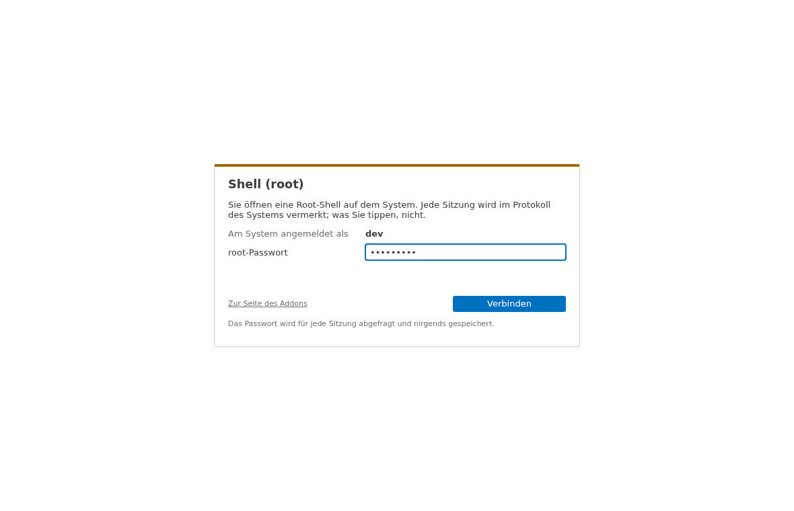

# lite-addon-shell

*[English](README.en.md)*

> **Braucht openccu-lite 2.0.0-beta.7 oder neuer.** Ein älteres System verweigert die Installation. **Wenn Sie
> einen ssh-Client haben, nehmen Sie den** - er ist in jeder Hinsicht das bessere Terminal. Dieses Addon ist für
> den Fall, dass keiner da ist.

Eine **Root-Shell im Browser** für [openccu-lite](https://github.com/openccu-lite/openccu-lite): ein Terminal in
einem eigenen Tab, für ein Tablet oder Telefon, einen verwalteten PC ohne ssh-Client oder ein System, das Sie nur
über seinen Webserver erreichen.


## Wie root erlangt wird, und warum das wichtig ist

openccu-lite hält root mit Absicht von seiner Weboberfläche fern: Der Systemdienst läuft ohne Sonderrechte, und was
root braucht, geht über einen kleinen Helfer, der nur tut, was seine Liste nennt. Ein Addon, das als root liefe und
jedem Angemeldeten eine Shell gäbe, würde das aufheben. **Dieses Addon läuft nicht als root und kann es von sich aus
nicht werden.**

- Es läuft **eingeschränkt**: eigener Benutzer, kein Zusatzrecht, keine Gruppe, kein Port und **kein Recht an der
  System-API**.
- Eine Sitzung ist eine **SSH-Anmeldung am SSH-Server des Systems** auf der Loopback-Adresse (`127.0.0.1:22`), als
  `root`, mit dem **root-Passwort, das Sie für jede Sitzung eingeben**. Das Passwort geht an die SSH-Verbindung und
  wird nirgends aufbewahrt: in keiner Datei, nicht im Protokoll, nicht für einen erneuten Verbindungsaufbau.
- Die Tür ist also die, die es schon gibt: **SSH muss eingeschaltet sein** (*System → Fernzugriff*). Das Addon
  schaltet es nie selbst ein, *SSH aus* schaltet auch die Shell aus, und ein System, das nur Schlüssel annimmt,
  bekommt von dieser Version keine Shell.
- Kein Code des Addons läuft als root. Der SSH-Server ist der, den das System mitbringt, und er prüft das Passwort.

Was sich ändert: **Das root-Passwort wird jetzt in eine Webseite getippt**, in einem Browser, auf einem Origin, den
sich die anderen Seiten und Addons des Systems teilen. Wer diesen Browser kontrolliert oder das root-Passwort
erfährt, kontrolliert das System und alle angelernten Geräte. Darum ist das Addon nach der Installation aus, fragt
vor dem Einschalten nach und schaltet sich selbst wieder aus.

## Was es tut

- **Ein Terminal** (xterm.js) auf einem echten pty: `TERM=xterm-256color`, UTF-8, folgt der Fenstergröße, 5000
  Zeilen Verlauf im Browser (keine auf dem System). Kopieren mit Strg+Umschalt+C, Einfügen mit Strg+Umschalt+V,
  Umschalt+Einfg oder dem Kontextmenü; Strg+C und Strg+V bleiben die des Terminals. **Beim Einfügen mehrerer Zeilen
  wird vorher gefragt**, einmal pro Sitzung.
- **Nach der Installation aus.** Ein Administrator schaltet es für **1 Stunde, 8 Stunden (Vorgabe) oder bis zum
  Ausschalten** ein. Solange es ein ist, steht ein **Hinweis auf der Statusseite des Systems**.
- **Eine Leiste, die nie verschwindet**, solange eine Sitzung offen ist: *Shell (root)*, das Konto, die Adresse des
  Clients, seit wann, und ein Countdown bis zum Ende ohne Eingabe. Ist eine Sitzung beendet, nennt die Leiste den
  Grund.
- **Limits** (alle drei auf der Seite des Addons einstellbar):

  | | Vorgabe | Bereich |
  | --- | --- | --- |
  | Eine Sitzung endet ohne Eingabe nach | 15 Minuten | 5 bis 60 |
  | Längste Sitzung | 8 Stunden | 1 bis 12 |
  | Sitzungen gleichzeitig, über alle Konten | 2 | 1 bis 4 |

  Ausgaben sind keine Eingabe: Ein laufendes `tail -f` hält keine Root-Shell offen. Fünf falsche Passwörter eines
  Kontos oder von einer Adresse sperren die Anmeldung für 15 Minuten; die Grenzen des SSH-Servers gelten zusätzlich.
- **Nur für Administratoren, mit ihrer Web-Sitzung.** Ein API-Token wird abgewiesen, gleich mit welchem Recht: Eine
  Root-Shell ist für einen Menschen, nicht für ein Programm. Läuft das System ohne Anmeldung, lässt sich das Addon
  nicht einschalten.
- **Eine Sitzung endet mit der Web-Sitzung, die sie geöffnet hat**: Abmelden, *überall abmelden*, eine
  Passwortänderung, der Ablauf, ein herabgestuftes Konto. Das Addon fragt das System alle 15 Sekunden, und zwar so,
  dass es nicht als Aktivität zählt - ein offenes Terminal hält Sie nicht angemeldet, und Tippen darin auch nicht.
  Sie endet außerdem, wenn das Addon ausgeschaltet wird oder seine Zeit um ist, wenn SSH ausgeschaltet wird, wenn
  der Dienst des Addons endet (ein Update, ein Neustart) und wenn ihr Tab länger als 30 Sekunden geschlossen
  bleibt. Ein Neuladen kommt zur Sitzung zurück. Für eine Shell, die überlebt, nehmen Sie `tmux` (in
  [lite-addon-tools](https://github.com/openccu-lite/lite-addon-tools)).
- **Nur über HTTPS.** Über einfaches HTTP sagt die Seite, wie Sie dorthin kommen, und öffnet nichts. Über ein
  Tunnel-Addon (WireGuard, Tailscale) wird die Shell **abgewiesen**, solange ein Administrator es nicht in den
  Einstellungen erlaubt: Die Firewall öffnet SSH nur für die lokalen Netze, und die Shell soll nicht still weiter
  reichen als SSH.
- **Die Seite des Terminals lässt sich nicht einbetten** und lädt nur ihre eigenen Skripte
  (`frame-ancestors 'none'`, `script-src 'self'`). Das Handle der Sitzung lebt im Tab - in keiner Adresse und in
  keinem Cookie -, eine andere Seite auf dem System kann sich also an keine Sitzung hängen. Nur die Web-Sitzung, die
  eine Sitzung geöffnet hat, kann sie benutzen; ein anderer Administrator kann sie beenden, nicht mitbenutzen.
- **Protokollzeilen**, im Protokoll des Systems (Unit `addon-shell`) und auf der Seite des Addons:
  `enabled until=… by=…`, `disabled by=… reason=…`, `session-open kind=terminal user=… client=… id=… auth=password`,
  `session-close id=… user=… reason=… duration=…`, `login-failed user=… client=… tries_left=…`, `login-locked …`,
  `settings by=…`. Der SSH-Server schreibt für jede Anmeldung seine eigene Zeile. **Was getippt wird und was eine
  Sitzung zeigt, wird nie protokolliert**: Es brächte jedes Passwort, das an einer Eingabeaufforderung getippt wird,
  ins Protokoll.
- Deutsch und Englisch, hell und dunkel.

Nicht in dieser Version: ein Dateibrowser und ein Editor, und eine Anmeldung für Systeme, die nur Schlüssel annehmen.

## Was ein Angreifer gewinnt

| Angreifer | Mit installiertem und eingeschaltetem Addon |
| --- | --- |
| Eine gestohlene Administrator-Sitzung | Das Anmeldeblatt, das das root-Passwort will. Ohne das nichts Neues. |
| Eine andere Seite auf dem Origin des Systems (die eines Addons) | Kann keine Sitzung öffnen oder erreichen. **Sie kann das Anmeldeblatt nachahmen** und nach dem root-Passwort fragen: Tippen Sie es nur in dem Tab, den die Seite des Addons geöffnet hat. |
| Der kompromittierte Browser eines Administrators | Liest und tippt in einem offenen Terminal und erfährt das root-Passwort bei der nächsten Anmeldung. |
| Ein Fehler im Dienst des Addons | Code, der als Benutzer des Addons läuft: Er reitet auf den gerade offenen Sitzungen mit und sieht die danach getippten Passwörter. Root ab der nächsten Anmeldung, nicht vorher. |
| Ein anderer Prozess auf dem System | Kann mit dem Loopback-Port des Addons sprechen und die Kopfzeilen des Webservers fälschen; er braucht trotzdem die laufende Web-Sitzung eines Administrators und das root-Passwort. |
| Jemand im Netz | Nichts im Klartext: Über einfaches HTTP wird die Shell abgewiesen. |

Für die Änderungen in einer Root-Shell stehen Sie ein, wie über ssh. Das Root-Dateisystem ist schreibgeschützt; was
Sie nach einem Remount außerhalb von `/usr/local` ändern, ist mit dem nächsten Systemupdate verloren.

## Installation

Auf der Seite **Addons** des Systems: *Shell* im Katalog, markiert mit **Root-Zugriff** - oder laden Sie das Paket
für Ihre Architektur aus den [Releases](https://github.com/openccu-lite/lite-addon-shell/releases) hoch
(`shell-aarch64-<version>.tar.gz`, `shell-x86_64-<version>.tar.gz`). Danach ist das Addon aus.

1. Schalten Sie **SSH** unter *System → Fernzugriff* ein und setzen Sie dort das root-Passwort, falls noch nicht
   geschehen.
2. Öffnen Sie das System über **https://**.
3. Auf der Seite des Addons: **Einschalten**, die Dauer wählen, dann **Shell öffnen**.
4. Im neuen Tab: das root-Passwort, **Verbinden**.
5. Schalten Sie das Addon aus, wenn Sie fertig sind.

Eine Deinstallation entfernt das Programm; die Limits bleiben für eine Neuinstallation in
`/usr/local/etc/config/addons/shell` (eine kleine Datei, kein Geheimnis). Der Schalter bleibt nicht: Nach jeder
Installation ist das Addon aus.

## Screenshots

| | |
| --- | --- |
|  |  |
|  |  |

## Die API des Addons

Die Routen unter `/addons/shell/api/v1` (jede braucht die Web-Sitzung eines Administrators, jeder Schreibzugriff
die Kopfzeile `X-CCU-Addon-Request`; nichts davon ist für ein Programm), das WebSocket-Protokoll des Terminals und
die Gründe, aus denen eine Sitzung endet, stehen in der [englischen Fassung](README.en.md#the-addons-own-api).

## Entwicklung

```sh
go test ./...                                   # die Units, gegen einen SSH-Server des Tests
SHELL_DOCKER=1 go test -count=1 ./test/sshd/     # Ende zu Ende gegen einen echten OpenSSH-sshd in docker
(cd ui && npm ci && npm run check && npm test && npm run build)
(cd ui && npx playwright install chromium && npx playwright test)   # die Seiten gegen scripts/dev-serve.sh
VERSION=0.1.0 scripts/build.sh                  # dist/shell-<arch>-<version>.tar.gz
```

`scripts/dev-serve.sh` startet den Dienst gegen einen Stellvertreter des Systems und einen SSH-Server, der das echte
Protokoll spricht und eine kleine eigene Shell ausführt - keine echte Shell, kein echtes System. Der Dienst ist Go
(`golang.org/x/crypto/ssh`, `github.com/coder/websocket`, das
[ccu-addon-kit](https://github.com/hobbyquaker/ccu-addon-kit)); die Seiten sind Svelte 5 auf
[occulite-ui](https://github.com/openccu-lite/occulite-ui) mit [xterm.js](https://xtermjs.org/).

## Lizenz

MIT. xterm.js steht unter MIT, `golang.org/x/crypto` unter BSD-3-Clause, `github.com/coder/websocket` unter ISC.
